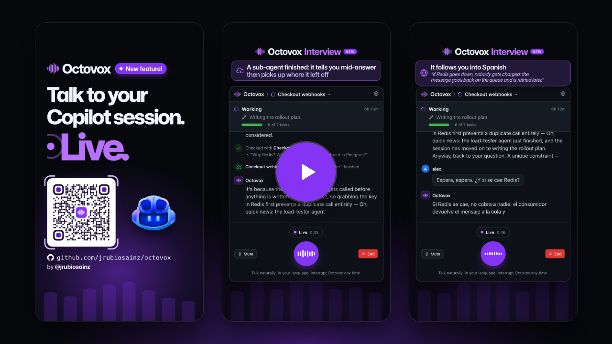
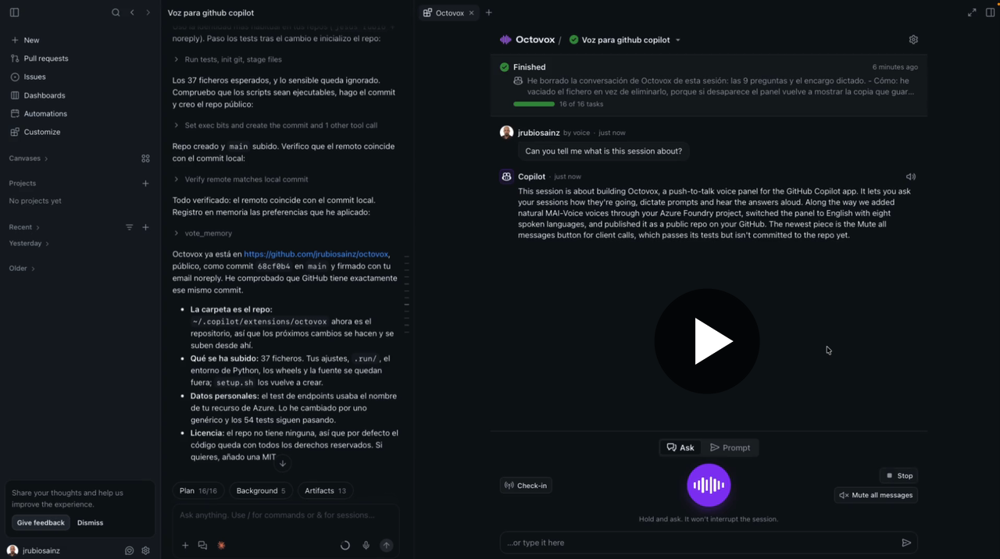

# Octovox · Talk to Copilot

**Octovox** (Octo + *vox*, "voice"; formerly *Walkie*) is a plugin — a canvas extension — for the **GitHub Copilot app**. It lets you talk to your sessions while they work:

- ask them how it's going **without interrupting them**;
- dictate prompts in **your own language**;
- answer their pending questions;
- hear the answers read aloud with **natural voices** (MAI-Voice on Azure AI Foundry, any OpenAI-compatible speech API, or the voices built into macOS);
- have a live, hands-free **Interview** about any session with GPT-Live: talk naturally, interrupt whenever you want, and it checks the details with the session without stopping it.

The panel is in English. You can speak in **English, Spanish, Italian, German, French, Portuguese, Dutch or Polish**, or let Octovox detect the language.

## New: Interview

[](https://cdn.jsdelivr.net/gh/jrubiosainz/octovox@main/docs/octovox-interview.mp4)

▶ [**Watch the Interview video with sound**](https://cdn.jsdelivr.net/gh/jrubiosainz/octovox@main/docs/octovox-interview.mp4) (1:07, vertical). Press **Interview** and just talk to a session that has been working for six hours: it tells you how it's going, checks with the session why it chose Redis over a unique constraint in Postgres without stopping it, breaks the news mid-answer when a sub-agent finishes and then picks up where it left off, and follows you into Spanish when you cut in. The session data is synthetic, the conversation is a real GPT-Live recording edited for length, and the Copilot mascot and GitHub logos come from the [GitHub Brand Toolkit](https://brand.github.com/). You can also [download the MP4](docs/octovox-interview.mp4). How it works and how to set it up: [Interview](#interview).

## Demo

[](https://cdn.jsdelivr.net/gh/jrubiosainz/octovox@main/docs/octovox-demo.mp4)

▶ [**Watch the product video with sound**](https://cdn.jsdelivr.net/gh/jrubiosainz/octovox@main/docs/octovox-demo.mp4) (1:00). Every Copilot session is a radio channel: questions in Spanish, German and French are answered aloud while the sessions keep working. It also shows the voice providers, a prompt dictated by voice, Check-in, spoken alerts, a question answered out loud and **Mute all messages** for calls. The sessions in it are synthetic, and the Copilot mascot and GitHub logos come from the [GitHub Brand Toolkit](https://brand.github.com/). You can also [download the MP4](docs/octovox-demo.mp4).

## What it does

| Mode | What happens |
| --- | --- |
| **Ask** (default) | Ask things like "How's it going?", "What have you found?" or "Do you need anything from me?". Octovox uses the runtime's ephemeral side question (`ui.ephemeralQuery`): no tools, nothing added to the history, and the session keeps working. The answer streams in and is read aloud sentence by sentence. |
| **Prompt** | Dictate a prompt and Octovox sends it to the session as if you had typed it. It can wait in the queue or steer the session at its next step (configurable). The chat shows only your text; the model also gets a short "dictated by voice" note. When the session finishes, Octovox reads you its reply. |
| **Reply** | When a session asks you something (`ask_user`), Octovox tells you and you can answer by voice: "the second one", "PostgreSQL", "yes, go ahead", "la segunda"… |
| **Check-in** | Asks every working session at once. The answers appear like a pull request's checks list, and you hear one sentence from each. |
| **Interview** | A live voice conversation about the selected session, with GPT-Live on Azure AI Foundry. No button to hold: just talk, and interrupt it whenever you want more detail. See [Interview](#interview). |
| **Spoken alerts** | Octovox tells you when a session asks you something, waits for you to approve a plan or a permission, or finishes a long task. |
| **Mute all messages** | One click, under **Stop**, silences every spoken answer, alert and sound in all your sessions, for example during a call with a customer. Answers and alerts keep appearing in the panel, and the header shows **Muted** until you click it again, even after a restart. |

When you ask the session the panel belongs to, it also gets the live status of your other sessions, so "how are my sessions doing?" works from anywhere.

## Interview

After hours of work, or a session left running overnight, catching up usually means prompt, wait, read, prompt again. **Interview** turns that into a conversation: press **Interview**, and Octovox's live voice tells you where the session is. Ask what it did and why, while you make coffee, and cut in whenever you want more detail, like with a teammate who watched the session.

- **It knows the session.** Octovox reads the session's own log (what you asked, what it did and said, what failed) and gives GPT-Live a briefing. While you talk, new events reach it quietly, so it's always up to date.
- **It checks with the session.** For details that aren't in the briefing (the exact reason for a decision, a test result, what a file contains), GPT-Live delegates and Octovox asks the session a side question. The session doesn't stop, and its answer comes back in your language. The panel shows each check, with the question and the answer.
- **News, the moment it happens.** When one of the session's helper agents finishes, Octovox tells you right away, even in the middle of an answer ("I just got an update: the load-tester finished, and the session moves on to the rollout plan"), then goes back to what it was explaining. If any of your sessions finishes or needs you, you hear it through the same voice.
- **Read-only.** It doesn't send prompts, approve plans or run anything. Use **Prompt** for that.
- **Controls:** the orb shows who's talking (it fills with purple when Octovox speaks, and an arc circles it while it checks with the session). Tap it, press **Mute** or the `M` key to turn your microphone off and on. **End** hangs up, and the transcript stays in the conversation, folded.
- **Limits:** it ends by itself after 10 minutes without hearing you, a minute after you close the panel, or at GPT-Live's one-hour session limit. One interview at a time, and push-to-talk, Check-in voice and spoken alerts wait until it ends. **Mute all messages** ends it.

**Setup:**

1. Deploy **`gpt-live-1`** in your Azure AI Foundry resource. Your account needs the **Cognitive Services OpenAI User** role on it.
2. In **Settings › Interview**, press **Find it in my Azure account** (it searches every subscription your Azure CLI can see), or paste the endpoint (`https://<resource>.openai.azure.com`) and the deployment name.
3. Sign-in uses Microsoft Entra ID through the Azure CLI (`az login`). There are no keys to store.

**Audio:** a small native helper (`native/duplex.swift`, built once with Xcode's command line tools) records and plays with **macOS voice processing**, the echo cancellation FaceTime uses, so GPT-Live doesn't hear itself through the speakers. Without the Swift compiler, Octovox uses SoX: the microphone pauses while Octovox speaks, so use headphones, or press **Talk over** (or hold the space bar) to interrupt.

## Voices

Pick the provider in **Settings › Voice**:

| Provider | Voices | Sign-in |
| --- | --- | --- |
| **Azure AI Foundry** (recommended) | **MAI-Voice-2.1** (default, the most natural), **MAI-Voice-2.1-Flash** (about 3× faster), MAI-Voice-2, MAI-Voice-2-Flash, and Azure neural and HD voices | **Microsoft Entra ID** through the Azure CLI (`az login`), with the *Cognitive Services User* or *Cognitive Services Speech User* role on the resource. Or an API key. |
| **OpenAI-compatible** | Any `/audio/speech` endpoint: `gpt-4o-mini-tts` on Azure OpenAI or OpenAI, `tts-1`, or a local server | An API key, or Entra ID on Azure OpenAI (*Cognitive Services OpenAI User* role) |
| **macOS voices** | The best installed `say` voice for each language; works offline | None |

- **Endpoints:** a Foundry resource (`https://<resource>.cognitiveservices.azure.com`), a Foundry project (`https://<resource>.services.ai.azure.com/api/projects/<project>`) or a regional Speech endpoint (`https://<region>.tts.speech.microsoft.com`, API key only).
- **One voice per language:** Octovox lists the voices your endpoint really offers for the chosen model (cached for 12 hours). Pick one per language and preview it with the speaker button. MAI-Voice isn't available in every Azure region.
- **Speed** goes from 0.7× to 1.6×. **Test voice** plays a sample and shows how long the first audio took.
- **Low latency:** the first sentence starts playing while the rest of the answer is still arriving, and the next sentence is synthesized while the current one plays. When you open the panel or press the talk button, Octovox signs in and warms the voice up with a tiny request, so the answer doesn't pay for it.
- **Fallback:** if the cloud voice fails, Octovox reads the text with the macOS voice and tells you why.
- **API keys** are stored in the **macOS Keychain** (service `Octovox`, one entry per provider and host), never in a settings file. They reach `security` through stdin, so they never show up in the process list.

## Languages

**Settings › Language › I speak** is either **Auto-detect** or one of the eight languages. Speech recognition runs locally with Whisper, limited to those languages, and Octovox answers in the language you chose or the one you just spoke. Spoken alerts use that language too.

## Design

Octovox follows GitHub's visual language, the **Primer** design system:

- **Header:** "Octovox / session ▾", with a picker like GitHub's repository or branch picker.
- **Session status:** like a GitHub Actions run summary, with the current step and its icon (terminal, search, edit…) and the task progress.
- **Pending questions:** an attention banner with the options as buttons.
- **Conversation:** like GitHub comments, with your GitHub avatar and Copilot's. Prompts, answers and alerts appear as timeline events.
- **Settings:** laid out like a GitHub settings page.
- **Talk button and mark:** eight voice-wave bars (octo = 8) that dance with your voice while you record.
- **Color:** Copilot purple (`#8534F3`) from the GitHub brand guidelines, used sparingly.
- **Type:** **Mona Sans** (GitHub's typeface) for the brand and headings; the system font everywhere else.
- **Theme:** follows the app's light or dark theme.

GitHub's brand guidelines don't allow the Octocat (Mona), the mascots, the Invertocat or the Copilot icon as the logo of your own project. So:

- Octovox has its own mark, the eight bars.
- The official Copilot icon (Octicons) appears only to represent Copilot, for example as the avatar of its answers.

## How to use it

1. In any session or chat, ask Copilot to **"open Octovox"**. It opens the `octovox` canvas.
2. **Hold** the purple button (or the **space bar**) and talk. Release to send.
   - A short tap keeps the microphone open until the next tap.
   - `Esc` cancels the recording or stops the voice.
3. Pick another session in the header to talk to it.
4. Press **Interview** (bottom left) for a live conversation about that session. Talk normally; press **End** when you're done.
5. Before a call, press **Mute all messages** (bottom right). Muting from any panel silences every session within a fraction of a second.
6. The gear opens **Settings**: language, voice, Interview, speed and behavior.

Sessions that were already open when you installed or updated Octovox load the new version when you reopen them in the app.

## How it works

```
  Octovox panel (canvas) ──HTTP 127.0.0.1──► its session's extension ──► session.rpc.ui.ephemeralQuery / session.send
         │                                            │
         │                               registry .run/peers/  (port + token, 0600)
         │                                            │
         └──────────────► another session's extension ┘  (side question, prompt, answer)

  Microphone: SoX `rec` ─► Whisper large-v3-turbo (MLX, local, 127.0.0.1:18766) ─► text + language
  Voice:      Azure AI Foundry MAI-Voice (SSML) · OpenAI-compatible /audio/speech · macOS `say`
              sentence by sentence, played with `afplay`
  Sounds:     the GitHub Copilot app's own dictation sounds (read from the installed app)
  Interview:  native audio helper (voice processing) ◄─PCM 24 kHz─► extension ◄─WebSocket─► GPT-Live
              briefing + live updates from the session's events.jsonl · delegations ─► side question
```

- **Install location:** a user extension in `~/.copilot/extensions/octovox`, loaded in every local session.
- **Security:** each session runs a small server on loopback only, with a random port and tokens. It checks the `Host` header and the `Content-Type`, and registers itself in `.run/peers/`.
- **Microphone:** recording happens in the extension process, so it uses the GitHub Copilot app's microphone permission.
- **Speech recognition:** local, with one server shared by every session. It unloads the model after 15 minutes without use and exits after an hour.
- **Privacy:** push-to-talk audio never leaves the Mac. With a cloud voice, the text Octovox reads aloud (answers and alerts) is sent to the endpoint you configured. Side questions go to each session's model, as usual. During an **Interview**, your microphone audio, a briefing built from the session's log and its live updates go to your GPT-Live deployment. Your public GitHub avatar is downloaded once and cached for a week.

## Requirements and setup

- macOS on Apple Silicon, with `brew install sox uv`.
- Run `./setup.sh`. It:
  - creates `stt/.venv` with `mlx-whisper` (offline when the wheels in `stt/.wheels` exist);
  - downloads Mona Sans into `ui/.fonts/` (without it, the panel uses the system font);
  - builds the Interview audio helper, if Xcode's command line tools are installed (`xcode-select --install`). Otherwise Octovox builds it the first time you start an interview.
- For Azure voices and Interview with Microsoft Entra ID: `brew install azure-cli` and `az login`.
- **Speech model:** `~/Library/Application Support/PodcastStudio/models/whisper-large-v3-turbo` when it exists; otherwise `mlx-community/whisper-large-v3-turbo` from Hugging Face. Override it with `OCTOVOX_STT_MODEL`.
- **Avatar:** the GitHub account the app is signed in with, or the one `gh` uses. Without one, the panel shows a generic icon.

## Data

| Path | Contents |
| --- | --- |
| `artifacts/settings.json` | Behavior settings, shared by every panel. |
| `artifacts/speech.json` | Language, speed and voice provider. It's a separate file so panels from the first version can't drop it. |
| `artifacts/muted` | Present while **Mute all messages** is on. Every Octovox process checks it before making a sound. |
| `artifacts/interview.json` | Interview's GPT-Live endpoint, deployment and voice. |
| macOS Keychain, service `Octovox` | API keys, one per provider and host. |
| `<session state>/octovox/history.jsonl` | Octovox's conversation with that session, including interview transcripts. Deleted with the session. |
| `.run/` | Live session registry, alert marks, the interview lock, the Interview audio helper, cached avatar and voice lists, temporary audio, `octovox.log` and `stt.log`. |

## Actions for agents

With the canvas open, an agent can call `invoke_canvas_action` with:

- `status`: the status of every session with Octovox (busy or idle, activity, tasks, pending questions).
- `ask_session`: a side question to another session, without interrupting it.
- `speak`: reads a short message aloud with the configured voice. During an interview, the live voice says it instead. While messages are muted it says nothing and returns `spoken: false`.

## Known limitations

- When you answer a question through Octovox, the session carries on right away, but the app may keep showing the question card in that session. You don't need to answer it there; if you do, it's ignored.
- Plans and permissions are approved in the app; Octovox only tells you about them.
- Side questions can't use tools: the session answers from what it already knows. That's also true of the checks an interview makes.
- GPT-Live is billed by the second while an interview is open, and each interview lasts at most an hour.
- Octovox only works with local sessions on this Mac.

## Tests

```bash
node --test test/*.test.mjs      # no network, Keychain or speakers needed
node test/demo.mjs [github-login] # demo panel with simulated sessions and a simulated interview (no GPT-Live, no sound)
```

Third-party notices are in [NOTICE.md](NOTICE.md).
